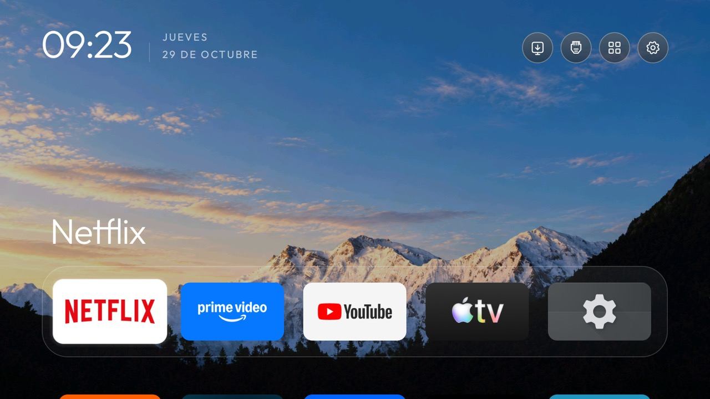

# Minimal Glass

A minimal Home screen with five columns, original app artwork, rounded cards, a translucent dock and restrained focus highlights. Morning, afternoon and night wallpapers follow the TV's local time. The base theme leaves the TV's Home selection and remote helpers unchanged; the optional [TCL G10 profile](TCL-G10.md) adds reversible Home redirection.



## Apply or reset

Build the launcher from this fork before applying the theme; older builds do not implement its glass header, folders or appearance controls. With ADB authorized:

```bash
TV_HOST='<tv ip>' tools/theme.sh themes/minimal-glass
```

Applying a theme clears local layout, motion and appearance overrides. It preserves owner-created folders, Home shortcut choices and saved ordering. Reset the theme to the built-in appearance with:

```bash
TV_HOST='<tv ip>' tools/theme.sh --reset
```

This resets appearance, not accessibility services or startup permissions. Use the [TCL rollback guide](TCL-G10.md) to restore Google TV.

## Artwork, spacing and focus

- Equally sized rounded cards prefer the app's horizontal TV banner, including configured artwork overrides. If no suitable banner exists, the full original icon fits within 84% of the card without stretching or cropping. An embedded square icon background is preserved.
- The dock has an extra 16dp before the first row below it. Layouts configured to fit additional rows reserve this space when calculating card sizes.
- Focus enlarges the card by 10%, with a restrained halo and no bounce. Original app logos remain unchanged.
- Circular header buttons use thin white vector icons and layered translucent fills. The network icon distinguishes Ethernet from Wi-Fi. Accessible descriptions and existing navigation remain available.

These enhancements are enabled by `glass_header: true`. Other themes using `uniform_tiles` retain their icon-only presentation. The launcher uses no blur, network access or new dependencies.

## Library and appearance

The App library opens from the top bar into a vertical grid. Its dark panel is at least 95% opaque and dims Home so the clock and app titles do not compete with the grid. Home and Settings use the same circular controls. In Spanish the count reads “N apps”, with extra space before Home.

Hold OK on an app to show its existing actions. Removing a shortcut from Home leaves the app installed and available in the library; Add to Home restores it.

Launcher settings provides:

| Choice | Behavior |
|---|---|
| Appearance | Theme default, Glass or Solid |
| Color mode | Theme default, Dark, Light or Automatic |
| Wallpaper dimming | Preview theme default or 0–90% dimming |
| Restore theme appearance | Remove local finish, palette and dimming overrides |

Automatic uses a light palette from 07:00 to 19:00 and dark otherwise. The existing dock opacity controls also affect the library, subject to its readability minimum. Solid uses opaque panels, a rim focus and disables the opacity controls until Glass or theme default is restored.

Selections preview immediately in settings. Closing the library or returning from settings restores the last Home selection when it remains available. Dialogs use matching light/dark surfaces and keep native Android selection, cancellation and accessibility behavior.

Library and settings entrances last 160ms, with a small upward movement. Reduced motion uses only a 90ms fade; disabling animations makes entry immediate.

## Folders with mosaic covers

Hold OK on a Home app, choose **Create folder**, enter a name, select the apps and confirm. The cover shows up to four original app images. Press OK to open the folder. Hold OK on it to edit its name or membership, move it, or delete it.

Deleting a folder restores individual Home shortcuts without uninstalling apps. Folders are stored locally, independently of the theme and saved app order. Apps already assigned to another folder are omitted from the picker. Up to 24 folders and 64 members per folder are supported; nested folders and module cards are excluded. Add an app from the library to Home before selecting it for a folder. Temporarily unavailable members retain their membership and return when available again.

## Wallpapers and ambient clock

Without latitude and longitude configured:

| Period | Wallpaper | Time |
|---|---|---|
| Morning | `wallpapers/01-morning.png` | 07:00–12:00 |
| Afternoon | `wallpapers/02-afternoon.png` | 12:00–19:00 |
| Night | `wallpapers/03-night.jpg` | 19:00–07:00 |

With coordinates, morning starts at sunrise and night starts 30 minutes after sunset. Wallpaper changes are evaluated while the launcher or its clock is visible, without a background scheduling service.

After five minutes without input on Home, the existing clock screensaver shows the wallpaper with a smaller drifting clock and date, 35% wallpaper dimming and no coloured glow. It pauses its Home timer while another window has focus, including the library, dialogs, settings and other apps. The first ordinary key is consumed and returns to Home; Android may handle system or dedicated app buttons itself.

Set `home_idle_clock_minutes` to `0` to disable it, or another number to change the delay. The other existing options are `clock_wallpaper`, `clock_wallpaper_dim` and `clock_glow`. The TV's own screensaver and sleep settings are preserved.

## Validation and limits

Tested on **TCL G10 / Smart TV, Android TV 12, firmware STT2.230203.001**, over Ethernet, and an Android TV 14 ARM64 emulator.

- Real-TV captures cover Home artwork, dock spacing, the library header, settings and automatic entry into the ambient clock. OK returned from the clock without launching an app. Its delay was temporarily one minute for verification, then restored to five.
- Folder creation, opening, persistence across APK updates and deletion were checked in the emulator; the Create folder menu was verified on the TV. Full folder editing and edge navigation still need physical-remote verification.
- The owner confirmed Home and off/on operation after enabling the optional TCL Home helper. This does not establish behavior after disconnecting mains power on other firmware.
- Final build and test evidence belongs in the PR description. No APKs, ADB keys, private backups or raw device diagnostics are committed.
- Alexa continues to depend on the TV's existing integration. This theme adds no voice assistant or subscription recommendations.
